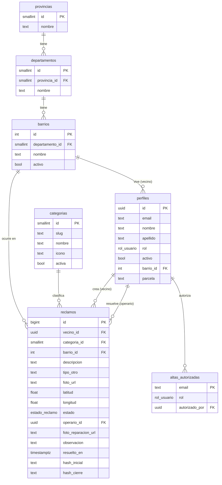

# 🏘️ Atención Ciudadana

Aplicación móvil en **Flutter + Supabase** para que los vecinos de Rawson (San Juan) reporten problemas en la vía pública (cunetas sucias, baches, luminarias rotas, basura acumulada u otro problema) y un operario municipal los resuelva, cerrando cada reclamo con una foto del trabajo terminado.

> Trabajo de la materia **Desarrollo Mobile** – Universidad Nacional de San Juan. Práctico N.º 3.

---

## 📌 Propósito y diferencial

El vecino saca una foto del problema, la app toma su ubicación GPS y él agrega una descripción. El reclamo queda **pendiente** en su barrio. Un operario lo atiende, saca una foto del arreglo y lo marca como **resuelto**.

Lo que distingue a la app:

- **Hash encadenado (trazabilidad):** cuando se crea un reclamo, la base calcula un `hash_inicial` (SHA-256) con todos sus datos. Cuando se resuelve, calcula un `hash_cierre` que incluye el hash inicial más los datos del arreglo. Así cualquier cambio posterior en los datos se puede detectar, y la municipalidad puede mostrar de forma verificable cuántos reclamos resolvió.
- **Antes / después:** cada reclamo resuelto guarda la foto del vecino y la foto del arreglo. El vecino las ve una al lado de la otra.
- **Organización por barrios:** provincia → departamento → barrio. El operario ve los barrios que tienen reclamos pendientes y cuántos tiene cada uno.

---

## 👥 Roles

Cada usuario tiene **un solo rol**. Después del login la app lo lleva a su pantalla de inicio.

| Rol | Qué hace |
|-----|----------|
| **Vecino** | Se registra solo desde la app (nombre, apellido, barrio y número de parcela). Carga reclamos con foto, ubicación y descripción. Consulta su historial; mientras un reclamo está pendiente puede editar la descripción o eliminarlo. |
| **Operario** | Lo da de alta el admin. Ve los barrios con reclamos pendientes, entra a cada reclamo (foto, descripción y mapa) y lo marca como realizado con la foto del arreglo y una observación opcional. |
| **Admin** | Ve el dashboard (totales, resueltos por operario y últimos resueltos con sus hashes). Crea, edita y activa/desactiva vecinos y operarios. Crea, edita y activa/desactiva barrios. Nunca elimina: desactiva. |

---

## ✨ Funcionalidades

**Cuenta**
- Registro de vecinos con barrio y parcela; login con email y contraseña.
- Un usuario desactivado no puede entrar ("Tu cuenta está desactivada").
- Cerrar sesión desde cualquier pantalla de inicio.

**Vecino**
- Lista de categorías leída desde Supabase (una categoría nueva aparece sin tocar el código).
- Categoría **"Otro problema"** para lo que no está en las opciones: el vecino escribe qué es (ej: "árbol caído") y se muestra como "Otro: árbol caído".
- Formulario del reclamo: barrio (arranca con el del vecino), descripción, foto con la cámara y mapa con la ubicación GPS actual.
- Notificación local al enviar (o si falla el envío) y diálogo de confirmación.
- **Mis reclamos**: historial del más nuevo al más viejo, filtro Todos / Pendientes / Resueltos, deslizar para actualizar.
- Detalle de un reclamo: antes/después, observación del operario y fecha de resolución si está resuelto; si está pendiente, editar descripción o eliminar.

**Operario**
- Barrios con reclamos pendientes y la cantidad de cada uno.
- Reclamos pendientes de un barrio, del más viejo al más nuevo.
- Detalle con foto del vecino, descripción y mapa; foto del arreglo obligatoria y observación opcional.
- Si dos operarios intentan cerrar el mismo reclamo, el segundo recibe "Este reclamo ya fue resuelto por otro operario".

**Admin**
- Dashboard: total, pendientes y resueltos; resueltos por operario; últimos 20 resueltos con hash inicial y de cierre.
- ABM de usuarios (vecinos y operarios) y de barrios, con activar/desactivar.

---

## 🛠️ Tecnologías

| Uso | Tecnología |
|-----|------------|
| App móvil | Flutter / Dart (Material 3) |
| Conexión con el backend | `supabase_flutter` |
| Base de datos | PostgreSQL (Supabase) |
| Autenticación | Supabase Auth (email y contraseña) |
| Fotos | Supabase Storage (bucket `reclamos`) |
| Cámara | `image_picker` |
| Permisos | `permission_handler` |
| Ubicación GPS | `geolocator` |
| Mapas | `flutter_map` + `latlong2` con mapas de OpenStreetMap |
| Notificaciones | `flutter_local_notifications` |

No hay backend propio: la lógica de negocio que tiene que ser segura (estados, hashes, permisos) vive en la base, con triggers y políticas RLS.

---

## 🗄️ Arquitectura de la base de datos

Los scripts están en [`supabase/`](supabase/), numerados en el orden en que se ejecutan.

### Tablas

| Tabla | Qué guarda |
|-------|------------|
| `provincias` | Provincias (San Juan). |
| `departamentos` | Departamentos de cada provincia (Rawson). |
| `barrios` | Barrios de cada departamento. `activo` en false = no aparece para elegir. |
| `categorias` | Tipos de reclamo (`slug`, nombre, descripción, ícono, `activa`). Incluye `otro`. |
| `perfiles` | Datos de cada usuario de Supabase Auth: nombre, apellido, rol, activo, barrio y parcela (solo vecinos). |
| `altas_autorizadas` | Emails autorizados a registrarse como operario o admin. |
| `reclamos` | El reclamo: vecino, categoría, barrio, descripción, `tipo_otro`, foto, latitud/longitud, fecha y `hash_inicial`; y los datos del cierre: estado, operario, foto del arreglo, observación, fecha de resolución y `hash_cierre`. |



Tipos propios: `rol_usuario` (`vecino`, `operario`, `admin`) y `estado_reclamo` (`pendiente`, `resuelto`).

### Vistas

- `barrios_con_pendientes`: barrios con la cantidad de reclamos pendientes (operario).
- `resumen_reclamos`: total, pendientes y resueltos (dashboard del admin).
- `resueltos_por_operario`: cuántos resolvió cada operario (dashboard del admin).

Las vistas usan `security_invoker`, así respetan los permisos de quien consulta.

### Triggers

- **Al crear un usuario** (`al_crear_usuario`): arma el perfil. Si el email está en `altas_autorizadas` le da ese rol; si no, lo crea como vecino (con barrio y parcela obligatorios).
- **Al editar un perfil** (`antes_de_editar_perfil`): desde la app nadie puede cambiar el rol ni el email de un perfil.
- **Al crear un reclamo** (`antes_de_crear_reclamo`): fuerza el estado `pendiente`, la fecha y deja vacíos los datos del cierre; valida `tipo_otro` (obligatorio en "Otro", null en el resto) y calcula el **hash inicial**.
- **Al modificar un reclamo** (`antes_de_realizar_reclamo`):
  - si sigue pendiente (edición del vecino): solo deja cambiar la descripción y `tipo_otro`, y recalcula el hash inicial;
  - si pasa a resuelto (operario): exige la foto del arreglo, registra el operario y la fecha, y calcula el **hash de cierre** encadenado al inicial;
  - un reclamo resuelto ya no se puede modificar.
- **Al eliminar un reclamo** (`antes_de_eliminar_reclamo`): un reclamo resuelto no se puede eliminar.

### Seguridad (RLS)

Todas las tablas tienen Row Level Security. La clave pública que está en la app no da acceso a nada por sí sola: lo que cada usuario puede hacer lo deciden las políticas según su rol (`mi_rol()`).

- Categorías activas, provincias, departamentos y barrios activos: los puede leer cualquiera (hacen falta en el registro). Operario y admin ven también los barrios desactivados.
- Perfiles: cada uno ve el suyo; el admin ve y edita los de vecinos y operarios.
- Reclamos:
  - el vecino crea reclamos a su nombre, ve **solo los suyos**, y edita o elimina **solo los suyos que están pendientes**;
  - el operario ve los reclamos y resuelve los pendientes;
  - el admin los ve para el dashboard.
- Storage (bucket `reclamos`): cada usuario sube y borra fotos solo en su carpeta `<id_usuario>/`; las fotos se pueden ver con su URL.
- Alta de operarios: solo el admin, mediante la función `admin_autorizar_operario`.

Cuando RLS bloquea un update o delete, Supabase no da error: devuelve 0 filas. Por eso la app pide `.select('id')` y, si la lista viene vacía, avisa que el reclamo ya fue resuelto.

---

## 🔁 Gestión de datos (CRUD) del Reclamo

El reclamo es la entidad principal. Todas las operaciones están en [`reclamos_provider.dart`](lib/src/providers/reclamos_provider.dart).

| Operación | Quién | Cómo | Validaciones en Dart | Validaciones en la base |
|-----------|-------|------|----------------------|--------------------------|
| **Alta** – `crearReclamo` | Vecino | Sube la foto a Storage y hace el insert. | Barrio elegido, descripción no vacía, "¿Qué problema es?" en "Otro", foto y ubicación obligatorias. | Descripción de 5 letras o más, coordenadas válidas, `tipo_otro` obligatorio en "Otro"; estado, fecha y hash los pone el trigger. |
| **Consulta** – `misReclamos` | Vecino | Select de sus reclamos, del más nuevo al más viejo. | — | RLS: solo ve los propios. |
| **Modificación** – `editarReclamo` | Vecino | Update de `descripcion` y `tipo_otro` con `.eq('estado', 'pendiente')`. | `Form` con `validator`: descripción obligatoria de 5 letras o más; "¿Qué problema es?" obligatorio en "Otro". | RLS: solo propios y pendientes. El trigger impide cambiar otros campos y recalcula el hash inicial. |
| **Eliminación** – `eliminarReclamo` | Vecino | Delete con `.eq('estado', 'pendiente')` y después borra la foto de Storage. | Diálogo de confirmación. | RLS: solo propios y pendientes. El trigger impide borrar un resuelto. |
| **Cierre** – `realizarReclamo` | Operario | Sube la foto del arreglo y pasa el reclamo a resuelto. | Foto del arreglo obligatoria. | Solo si sigue pendiente; el trigger registra operario, fecha y hash de cierre. |

Un reclamo resuelto queda sellado: es el registro de la gestión, no se modifica ni se elimina.

---

## 🔐 Permisos de Android

Declarados en [`AndroidManifest.xml`](android/app/src/main/AndroidManifest.xml):

| Permiso | Para qué |
|---------|----------|
| `INTERNET` | Conectarse a Supabase (base, login y fotos) y descargar los mapas de OpenStreetMap. |
| `CAMERA` | Sacar la foto del problema (vecino) y la del arreglo (operario). La foto es la prueba del reclamo, por eso se saca en el momento. |
| `ACCESS_FINE_LOCATION` / `ACCESS_COARSE_LOCATION` | Marcar en el mapa dónde está el problema, para que el operario sepa adónde ir. |
| `POST_NOTIFICATIONS` | Desde Android 13, para avisar en la barra de notificaciones si el reclamo se envió o no. |

**Flujo de permisos** (en [`camara_service.dart`](lib/src/services/camara_service.dart), [`ubicacion_service.dart`](lib/src/services/ubicacion_service.dart) y [`foto_util.dart`](lib/src/utils/foto_util.dart)):

1. **Consultar** el estado del permiso.
2. Si no está dado, **pedirlo** en el momento en que hace falta (al tocar "sacar foto" o al abrir el formulario del reclamo).
3. Si lo dio, **usar** la cámara o el GPS. Si lo rechazó, se muestra un mensaje explicando para qué se necesita.
4. Si quedó **bloqueado** (rechazado para siempre), se ofrece **abrir los ajustes** del celular para habilitarlo.

Para la ubicación, además, se chequea antes que el GPS esté prendido.

---

## 📁 Estructura de `lib/src/`

```
lib/
├── main.dart                 # Inicializa Supabase y las notificaciones, y arranca la app
└── src/
    ├── app.dart              # MaterialApp: tema general y rutas
    ├── config/               # Datos de conexión a Supabase (URL y clave pública)
    ├── models/               # Clases de datos con fromJson (reclamo, categoría, barrio, perfil, usuario, dashboard)
    ├── providers/            # Los únicos que usan Supabase: auth, reclamos, categorías, barrios y admin
    ├── services/             # Cámara, ubicación y notificaciones (hablan con el celular)
    ├── pages/                # Pantallas de cada rol
    │   └── admin/            # Pestañas y diálogos del panel del admin
    ├── routes/routes.dart    # Rutas con nombre; las que necesitan un dato lo reciben como argumento
    ├── utils/                # Ayudas: ícono a partir del nombre, sacar foto con permiso
    └── widgets/              # Piezas reutilizables: VistaFoto, MapaUbicacion, BotonCerrarSesion, AnchoMaximo
```

Cada provider tiene una instancia global (por ejemplo `reclamosProvider`) que usan las pantallas. Los errores llegan a la pantalla como excepciones con un mensaje ya listo para mostrar (`ReclamoException`, `AdminException`, `UbicacionException`).

---

## ▶️ Cómo ejecutarlo

1. Crear un proyecto en [Supabase](https://supabase.com).
2. En **Authentication → Sign In / Providers → Email**, desactivar **"Confirm email"** (así el vecino puede entrar apenas se registra).
3. En el **SQL Editor**, ejecutar en orden:
   1. `supabase/esquema/01_tipos.sql` a `supabase/esquema/10_historial_y_otro.sql`
   2. `supabase/seed.sql` (provincia, departamento, barrios y categorías)
   3. `supabase/crear_admin.sql` (siguiendo las instrucciones del archivo)
   4. Opcional: `supabase/crear_operario_prueba.sql`
   - `supabase/reiniciar.sql` sirve solo para borrar todo y empezar de cero.
4. Completar `lib/src/config/supabase_config.dart` con la URL y la clave pública (*publishable key*) del proyecto.
5. Instalar dependencias y correr:

```bash
flutter pub get
flutter run
```

---

## 🚀 Mejoras planificadas

- Notificaciones push al vecino cuando su reclamo se resuelve.
- Elegir la foto desde la galería además de la cámara.
- Mapa general con todos los reclamos y su estado.
- Asignación de operarios por zona.
- Caché para usar la app sin conexión.
- Panel web separado para la municipalidad.

---

## 👤 Autor

**Javier Andrés Rojas Masuelli** — GitHub [@javierrojas62](https://github.com/javierrojas62)
